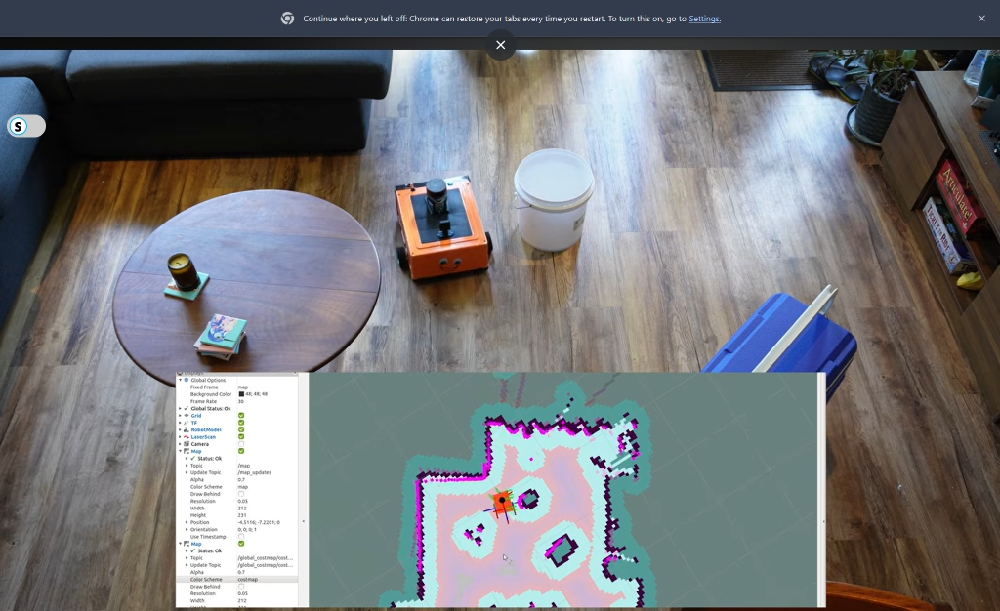
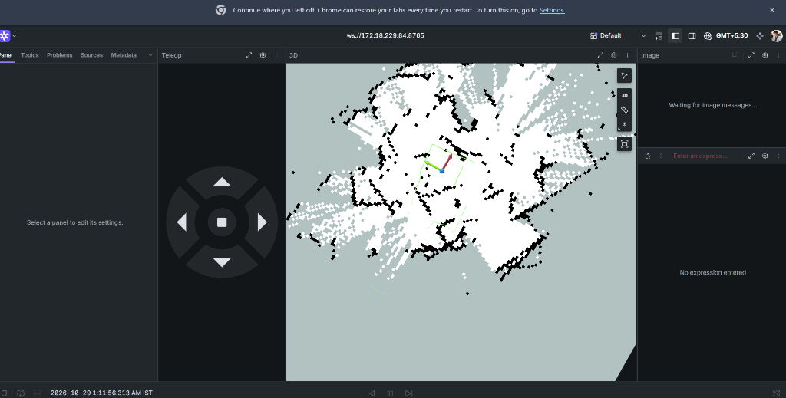
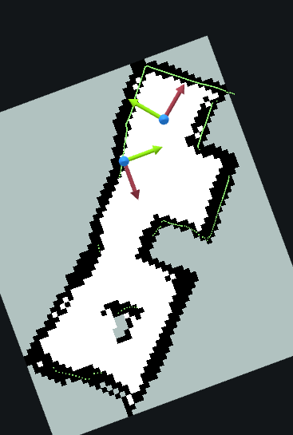
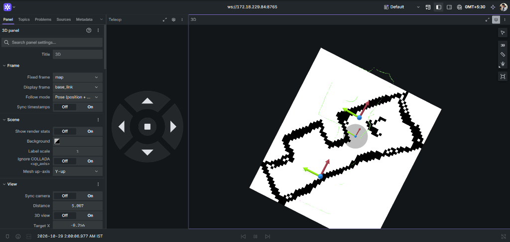
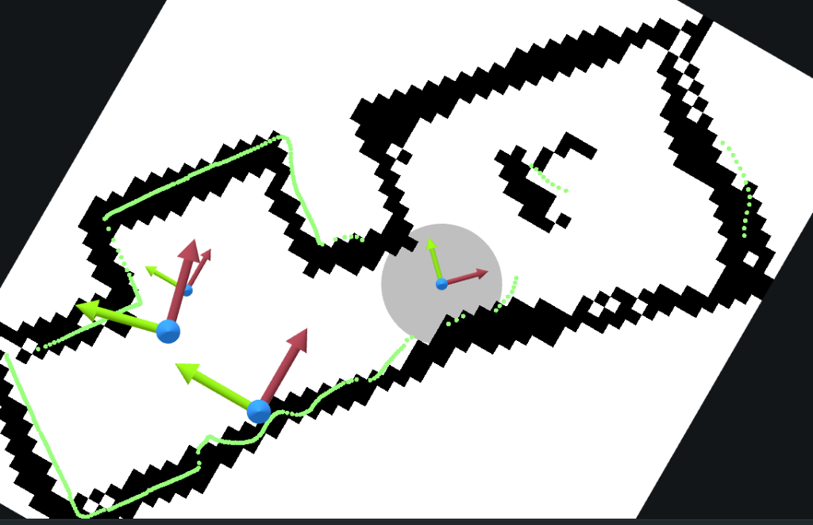
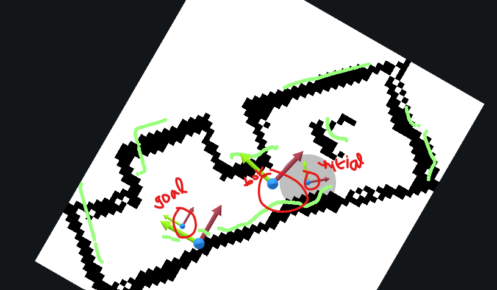

# Autonomous Mobile Robot (AMR) - Complete Engineering & Student Guide
### Waveshare UGV02 6-Wheel Rover | Raspberry Pi 5 | ROS 2 Jazzy | SLAM Toolbox | Nav2


---

## Table of Contents
1. [Introduction & Robot Showcase](#1-introduction--robot-showcase)
2. [Repository Directory Structure](#2-repository-directory-structure)
3. [Step 1: Raspberry Pi 5 Setup, Headless Booting & SSH](#3-step-1-raspberry-pi-5-setup-headless-booting--ssh)
4. [Step 2: ROS 2 Jazzy Installation & Dependencies](#4-step-2-ros-2-jazzy-installation--dependencies)
5. [Step 3: Hardware Architecture & Wiring](#5-step-3-hardware-architecture--wiring)
6. [Step 4: Serial Communication & Fused IMU Gyro Odometry](#6-step-4-serial-communication--fused-imu-gyro-odometry)
7. [Step 5: Visualizing LiDAR & Remote Telemetry (RViz2 vs Foxglove)](#7-step-5-visualizing-lidar--remote-telemetry-rviz2-vs-foxglove)
8. [Step 6: 2D Mapping with SLAM Toolbox](#8-step-6-2d-mapping-with-slam-toolbox)
9. [Step 7: AMCL Localization & Setting Initial Pose](#9-step-7-amcl-localization--setting-initial-pose)
10. [Step 8: Autonomous Navigation with Nav2 (MPPI Controller)](#10-step-8-autonomous-navigation-with-nav2-mppi-controller)
11. [Step 9: Diagnostics, Common Errors & Solutions Matrix](#11-step-9-diagnostics-common-errors--solutions-matrix)
12. [Step 10: Future Enhancements & Scope of Improvement](#12-step-10-future-enhancements--scope-of-improvement)
13. [References & Brochure](#13-references--brochure)

---

## 1. Introduction & Robot Showcase

This repository is a comprehensive, production-grade guide for building, calibrating, mapping, and autonomously navigating an **Autonomous Mobile Robot (AMR)** using the **Waveshare UGV02** 6-wheel rover chassis. 

Whether you are a university student, robotics engineer, or researcher, this repository provides everything needed to take a bare robot chassis with a Raspberry Pi 5, integrate a 360° laser scanner and 9-axis IMU, solve complex real-world skid-steer friction slip, generate pristine 2D floor plans, and command point-and-click autonomous navigation.

<p align="center">
  
  <br>
  <em>Figure 1: The Waveshare UGV02 6-wheel mobile robot equipped with Raspberry Pi 5 and LDROBOT LD19 LiDAR.</em>
</p>

### Key Highlights:
- **Calibrated IMU Gyro Odometry Fusion:** Solves skid-steer wheel scrubbing friction to produce 100% drift-free rotational odometry.
- **Fail-Safe Map Exporting:** Eliminates ROS 2 Jazzy QoS subscription timeouts with a custom zero-dependency map exporter.
- **Optimized for Embedded Edge Compute:** MPPI and Navfn planners fine-tuned to run at full 10–20 Hz without thermal throttling or starving the Raspberry Pi 5 CPU.
- **Modern Web Telemetry:** Foxglove Studio integration over WebSockets for zero-latency 3D visualization and teleoperation.

---

## 2. Repository Directory Structure

```text
Autonomous-Mobile-Robot-AMR-/
│
├── README.md                           # Master student & engineering guide
│
├── docs/                               # Datasheets, architecture guides & brochures
│   └── Waveshare_UGV02_Brochure.pdf    # Official Waveshare UGV02 chassis brochure
│
├── media/                              # Images and demo recordings
│   ├── images/
│   │   ├── ugv02_robot_chassis.jpg     # Hardware photo of the rover
│   │   ├── slam_mapping_foxglove.png   # Real-time SLAM Toolbox map generation in Foxglove
│   │   ├── clean_2d_room_map.png       # High-resolution generated room map with scan alignment
│   │   ├── foxglove_display_frame.png  # Critical Display Frame configuration in Foxglove
│   │   ├── foxglove_pose_settings.png  # Topic settings for 2D pose estimate and goal
│   │   ├── foxglove_pose_tool.png      # Selecting 2D Pose Estimate tool
│   │   ├── amcl_localization_lock.png  # Millimeter-level AMCL localization lock
│   │   └── nav2_autonomous_goal_test.png # Point-and-click autonomous goal execution
│   └── videos/
│       └── README.md                   # Instructions for placing video demonstrations
│
├── src/                                # Source code and ROS 2 nodes
│   ├── base_driver/
│   │   └── ugv02_base_node.py          # Serial communication, startup gyro auto-zero, fused odometry & TF
│   ├── lidar/
│   │   └── ld19.launch.py              # LD19 LiDAR driver and base_link -> base_laser static TF
│   └── utils/
│       ├── goal_relay.py               # Bridges Foxglove goal topics to Nav2 /goal_pose
│       ├── save_map_safe.py            # Fail-safe P5 binary PGM and YAML map exporter
│       └── set_pose.py                 # Command-line initial pose publisher for testing
│
├── config/                             # Production-tuned parameter files
│   ├── mapper_params_online_async.yaml # Calibrated SLAM Toolbox configuration
│   └── nav2_params.yaml                # Pi 5 optimized Nav2 stack configuration (MPPI + Navfn)
│
└── maps/                               # Verified 2D occupancy grid maps
    ├── my_room_map.yaml                # Map metadata (resolution, origin, thresholds)
    └── my_room_map.pgm                 # 2D occupancy grid P5 image
```

---

## 3. Step 1: Raspberry Pi 5 Setup, Headless Booting & SSH

For an Autonomous Mobile Robot, operating "headless" (without a monitor, keyboard, or mouse attached to the robot) is mandatory.

### 1. Flashing the Operating System
1. Download and install **Raspberry Pi Imager** on your PC.
2. Select **Raspberry Pi 5** as the target device.
3. Under Operating System, choose **Ubuntu 24.04 LTS (Server, 64-bit)**.
4. Click **Edit Settings** (OS Customization) before flashing:
   - **Hostname:** `robopi`
   - **Username / Password:** `robopi` / `robopi`
   - **Configure Wireless LAN:** Enter your Wi-Fi SSID and Password. Set Country to your local region.
   - **Services:** Check **Enable SSH** with password authentication.
5. Insert your high-speed MicroSD card (UHS-I A2 recommended, $\ge 32\text{GB}$) and click **Write**.

### 2. Booting and Finding the IP Address
1. Insert the MicroSD card into the Raspberry Pi 5 and power it via a 5V/5A USB-C power supply or a step-down buck converter connected to the robot battery.
2. Allow 60–90 seconds for initial boot and Wi-Fi connection.
3. On your PC (connected to the same Wi-Fi network), open a terminal and find the Pi's IP:
   ```bash
   ping robopi.local
   # Or scan your local subnet:
   arp -a | grep -i b8:27:eb   # or Raspberry Pi OUI dc:a6:32 / 28:cd:c1
   ```
4. Connect via SSH:
   ```bash
   ssh robopi@<PI_IP_ADDRESS>
   ```

### 3. Enabling Hardware UART for ESP32 Communication
By default, Ubuntu enables a serial Linux login console on the Pi's primary UART. We must free this UART so ROS 2 can communicate directly with the ESP32 driver board:

1. Open `/boot/firmware/config.txt`:
   ```bash
   sudo nano /boot/firmware/config.txt
   ```
2. Add the following lines to the bottom:
   ```ini
   enable_uart=1
   dtoverlay=uart0
   ```
3. Open `/boot/firmware/cmdline.txt`:
   ```bash
   sudo nano /boot/firmware/cmdline.txt
   ```
   **Remove** any mention of `console=serial0,115200` or `console=ttyAMA0,115200`. Save and exit.
4. Disable the serial console service and add permissions:
   ```bash
   sudo systemctl stop serial-getty@ttyAMA0.service
   sudo systemctl disable serial-getty@ttyAMA0.service
   sudo usermod -a -G dialout robopi
   sudo reboot
   ```

---

## 4. Step 2: ROS 2 Jazzy Installation & Dependencies

After rebooting, log back in via SSH and install ROS 2 Jazzy:

```bash
# 1. Ensure UTF-8 locale
sudo apt update && sudo apt install -y locales
sudo locale-gen en_US en_US.UTF-8
sudo update-locale LC_ALL=en_US.UTF-8 LANG=en_US.UTF-8
export LANG=en_US.UTF-8

# 2. Add the ROS 2 official GPG key and repository
sudo apt install -y software-properties-common curl gnupg lsb-release
sudo curl -sSL https://raw.githubusercontent.com/ros/rosdistro/master/ros.key -o /usr/share/keyrings/ros-archive-keyring.gpg
echo "deb [arch=$(dpkg --print-architecture) signed-by=/usr/share/keyrings/ros-archive-keyring.gpg] http://packages.ros.org/ros2/ubuntu $(. /etc/os-release && echo $UBUNTU_CODENAME) main" | sudo tee /etc/apt/sources.list.d/ros2.list > /dev/null

# 3. Update package index and install ROS 2 Base
sudo apt update
sudo apt install -y ros-jazzy-ros-base python3-colcon-common-extensions python3-rosdep

# 4. Install Navigation, SLAM and Foxglove packages
sudo apt install -y \
  ros-jazzy-navigation2 \
  ros-jazzy-nav2-bringup \
  ros-jazzy-slam-toolbox \
  ros-jazzy-foxglove-bridge \
  ros-jazzy-tf2-ros \
  ros-jazzy-tf2-tools \
  python3-serial

# 5. Add ROS 2 environment variables to bashrc
echo "source /opt/ros/jazzy/setup.bash" >> ~/.bashrc
source ~/.bashrc
```

---

## 5. Step 3: Hardware Architecture & Wiring

```
+-------------------------------------------------------------------+
|                        Waveshare UGV02 Chassis                    |
|                                                                   |
|   Left Front Wheel     [===]               [===] Right Front Wheel|
|   Left Middle Wheel    [===]   +-------+   [===] Right Mid Wheel  |
|   Left Rear Wheel      [===]   | LiDAR |   [===] Right Rear Wheel |
|                                +-------+                          |
|                                    | (USB)                        |
|   +--------------------+           v          +---------------+   |
|   | 3S LiPo Battery    |-----> [ Pi 5 ] <---> | ESP32 Driver  |   |
|   | (11.1V - 12.6V)    |          ^   (UART)  | Board + 9-IMU |   |
|   +--------------------+          |           +---------------+   |
|            |                      |                   |           |
|            v                      |                   v           |
|     [Buck Converter] -------------+           [6x Motor Drivers]  |
|        (5V / 5A)                                                  |
+-------------------------------------------------------------------+
```

### Pinout Connections:
- **ESP32 to Raspberry Pi 5 UART:**
  - ESP32 `TX` $\to$ Pi 5 `GPIO 15 (RXD / UART0)`
  - ESP32 `RX` $\to$ Pi 5 `GPIO 14 (TXD / UART0)`
  - ESP32 `GND` $\to$ Pi 5 `GND` (Pin 6)
- **LiDAR Connection:**
  - LDROBOT LD19 USB adapter plugged into any USB 3.0/2.0 port on the Pi 5 (`/dev/ttyUSB0`).

### Coordinate Alignment (REP-103):
- **+X (Red):** Points straight forward to the front bumper.
- **+Y (Green):** Points $90^\circ$ left.
- **+Z (Blue):** Points vertically up.

> [!CAUTION]
> **LiDAR Mounting Orientation:** The LD19 LiDAR has a cable breakout connector. Mount the LiDAR so that its internal zero-angle aligns with the chassis front (+X). If mounted sideways, laser reflections will move perpendicular to actual robot translation!

---

## 6. Step 4: Serial Communication & Fused IMU Gyro Odometry

### The Skid-Steer Scrubbing Problem
Standard differential drive kinematics assume pure rolling without lateral slip:
$$v = \frac{v_r + v_l}{2}, \quad \omega = \frac{v_r - v_l}{L}$$
Where $L$ is the track width. On a 6-wheel skid-steer rover, turning forces all 6 wheels to scrub laterally against the floor. As a result:
- The effective track width $L$ changes dynamically based on the floor surface.
- Wheel encoders overestimate or underestimate rotation by up to $40\%$.
- A $360^\circ$ physical spin results in a distorted $210^\circ$ or $480^\circ$ odometry reading, causing SLAM to build overlapping, warped card-deck maps.

### The IMU Gyro Fusion Solution
To solve this permanently without expensive external motion capture:
1. **Linear Displacement** is calculated from the average of left and right encoders:
   $$\Delta d = \frac{\Delta d_{\text{left}} + \Delta d_{\text{right}}}{2}$$
2. **Rotational Heading** is calculated strictly by integrating the calibrated Gyroscope $Z$-axis rate:
   $$w_z = \frac{\text{raw\_gz} - \text{bias}}{924.3} \text{ [rad/s]}$$
   $$\theta_{t} = \theta_{t-1} + w_z \cdot \Delta t$$
3. **Planar Odometry Integration:**
   $$x_t = x_{t-1} + \Delta d \cdot \cos\left(\theta_{t-1} + \frac{w_z \Delta t}{2}\right)$$
   $$y_t = y_{t-1} + \Delta d \cdot \sin\left(\theta_{t-1} + \frac{w_z \Delta t}{2}\right)$$

### Auto-Zero Bias Calibration
On startup, [`ugv02_base_node.py`](file:///Z:/src/base_driver/ugv02_base_node.py) collects 50 consecutive gyro readings (~1 second) while the rover sits stationary. It computes the average sensor offset $\text{bias} = \frac{1}{N}\sum \text{raw\_gz}$ and subtracts it in real-time, eliminating temperature-induced drift.

---

## 7. Step 5: Visualizing LiDAR & Remote Telemetry (RViz2 vs Foxglove)

While desktop ROS 2 uses RViz2, running RViz2 on a remote headless robot over SSH X11 forwarding causes heavy packet loss, low frame rates, and severe rendering lag.

### The Modern Alternative: Foxglove Studio
We stream telemetry directly using **Foxglove Studio** via a lightweight native WebSocket bridge:

```
[ Raspberry Pi 5 ]                                  [ Remote PC / Laptop ]
+-------------------+                               +--------------------+
|  ROS 2 Topics     |                               |  Foxglove Studio   |
|  (/scan, /odom,   |                               |  (Web / Desktop)   |
|   /tf, /map)      |                               |                    |
+---------+---------+                               +---------^----------+
          |                                                   |
+---------v---------+          WebSocket (Port 8765)          |
|  foxglove_bridge  | ========================================+
+-------------------+
```

### Running the Bridge:
```bash
ros2 run foxglove_bridge foxglove_bridge
```
On your PC, open Foxglove Studio, select **Open connection**, and enter:
```text
ws://<PI_IP_ADDRESS>:8765
```

### Essential Foxglove Layout Panels:
1. **3D Panel:** Add topics `/scan` (Color mode: Flat Green), `/map`, and `/tf`.
2. **Teleop Panel:** Publishes directly to `/cmd_vel` using a virtual joystick or keyboard arrows.
3. **Image Panel:** Displays live camera feed (if camera is attached).

---

## 8. Step 6: 2D Mapping with SLAM Toolbox

We use **SLAM Toolbox** (`online_async_launch.py`) for lifelong, real-time Ceres-solver graph SLAM.

<p align="center">
  
  <br>
  <em>Figure 2: Real-time 2D SLAM mapping in Foxglove Studio. The green laser scan perfectly traces the walls as the robot moves.</em>
</p>

### Mapping Procedure:
1. **Terminal 1:** Run Base Node:
   ```bash
   python3 /home/robopi/ugv02_base_node.py
   ```
2. **Terminal 2:** Run LiDAR:
   ```bash
   ros2 launch ldlidar_ros2 ld19.launch.py port_name:=/dev/ttyUSB0
   ```
3. **Terminal 3:** Run Foxglove Bridge:
   ```bash
   ros2 run foxglove_bridge foxglove_bridge
   ```
4. **Terminal 4:** Launch SLAM Toolbox:
   ```bash
   ros2 launch slam_toolbox online_async_launch.py slam_params_file:=/home/robopi/mapper_params_online_async.yaml
   ```
5. In Foxglove, use the **Teleop** pad to drive the robot smoothly through the space.
6. **Closing the Loop:** Drive the robot back to its exact starting location. SLAM Toolbox will match the initial scan features and lock the graph with zero cumulative drift!

<p align="center">
  
  <br>
  <em>Figure 3: Final pristine, loop-closed 2D occupancy grid map (`my_room_map.pgm`).</em>
</p>

### Saving the Map (Solving the 2-Second CLI Timeout Bug)
Standard `ros2 run nav2_map_server map_saver_cli` often fails in ROS 2 Jazzy with `Failed to spin map subscription` due to QoS mismatches. 

**While SLAM is still running**, open a terminal and run our fail-safe exporter:
```bash
python3 /home/robopi/save_map_safe.py
```
This generates `/home/robopi/my_room_map.pgm` and `/home/robopi/my_room_map.yaml` in 0.2 seconds.

---

## 9. Step 7: AMCL Localization & Setting Initial Pose

Once the map is saved, stop SLAM Toolbox (`Ctrl+C`). Launch Nav2 with the saved map:

```bash
ros2 launch nav2_bringup bringup_launch.py map:=/home/robopi/my_room_map.yaml params_file:=/home/robopi/nav2_params.yaml use_sim_time:=false
```

### The Critical "Display Frame" Fix in Foxglove
If you click on the map to set the robot's pose and AMCL outputs:
```text
[WARN] [amcl]: Ignoring initial pose in frame "base_link"; initial poses must be in the global frame, "map"
```
Follow these exact steps:

<p align="center">
  
  <br>
  <em>Figure 4: Setting Display frame to 'map' and Follow mode to 'None' in Foxglove 3D panel settings.</em>
</p>

1. Open the 3D panel settings (Gear icon ⚙️ in the 3D panel title bar).
2. Set **Fixed frame:** `map`
3. Set **Display frame:** `map` (Do not leave it on `base_link`!)
4. Set **Follow mode:** `None`

### Snapping the Robot into Position:
1. Click the tool dropdown in the 3D panel and pick **`Publish 2D pose estimate (/initialpose)`**.
2. Click on the map where the robot is physically sitting, drag the arrow in the direction the robot is facing, and release.
3. **Verification:** The green laser dots will instantly snap directly on top of the black walls!

<p align="center">
  
  <br>
  <em>Figure 5: Millimeter-accurate AMCL particle filter convergence. The green laser reflections lock tightly onto the black walls.</em>
</p>

---

## 10. Step 8: Autonomous Navigation with Nav2 (MPPI Controller)

### Sending an Autonomous Goal
1. In the 3D panel toolbar, select **`Publish 2D pose (/goal_pose)`**.
2. Click in the **open white space** on the map (avoid clicking on top of black walls) and drag the arrow in the desired heading.
3. The robot will compute a global plan, smoothly turn on the spot to face the trajectory, and drive autonomously to the target!

<p align="center">
  
  <br>
  <em>Figure 6: Nav2 autonomous path generation and execution from start pose to destination.</em>
</p>

### Controller Tuning on Raspberry Pi 5
In [`nav2_params.yaml`](file:///Z:/config/nav2_params.yaml), we implemented the following critical optimizations:
- **`expected_planner_frequency: 1.0 Hz`** (Reduced from 20 Hz): Prevents CPU starvation on the Pi 5.
- **`controller_frequency: 10.0 Hz`**: Guarantees zero missed control cycles.
- **`batch_size: 200`, `time_steps: 25`**: Right-sized for ARM Cortex-A76 cores.
- **`vy_std: 0.0`, `vy_max: 0.0`**: Strictly enforces non-holonomic differential drive constraints.
- **`PathAngleCritic: 10.0`**: Forces the robot to rotate on the spot to face the path heading before moving forward.
- **`TwirlingCritic: 12.0`**: Eliminates rapid left/right oscillation and spinning.
- **`inflation_radius: 0.22m` (`cost_scaling_factor: 10.0`)**: Slimmed down from 0.30m so narrow indoor corridors and doorways are never choked off as impassable.

---

## 11. Step 9: Diagnostics, Common Errors & Solutions Matrix

| Symptom / Error Message | Root Cause | Solution |
|---|---|---|
| **Map fans out like a deck of cards when turning** | Skid-steer rubber wheel scrubbing causes severe wheel encoder slip. | Calibrate IMU Gyroscope scale factor (`924.3 LSB / (rad/s)`) and fuse yaw in `ugv02_base_node.py`. |
| **Laser scan moves perpendicular to walls during translation** | LiDAR physical mounting is rotated $90^\circ$ relative to chassis frame. | Rotate physical LiDAR mounting so Red (+X) is Front and Green (+Y) is Left (REP-103). |
| **`[map_saver]: Failed to spin map subscription`** | Nav2 `map_saver_cli` enforces a 2s timeout and QoS mismatch on `/map`. | Use `save_map_safe.py` which supports both Transient Local and Volatile QoS profiles with a 15s timeout. |
| **`[amcl]: Ignoring initial pose in frame "base_link"`** | Foxglove 3D panel Display Frame was set to `base_link` with Follow Mode active. | In Foxglove 3D settings, change **Display frame** to `map` and **Follow mode** to `None`. |
| **`Planner loop missed its desired rate of 20.0 Hz (1.0 Hz actual)`** | Global planner recalculating A* paths 20 times per second, maxing out CPU. | Set `expected_planner_frequency: 1.0` in `nav2_params.yaml`. |
| **`Control loop missed desired rate of 20.0 Hz (5.5 Hz actual)`** | MPPI controller running desktop GPU batch size (`2000`) on Raspberry Pi CPU. | Set `controller_frequency: 10.0`, `batch_size: 200`, and `time_steps: 25`. |
| **Robot stutters, twitches left/right rapidly while driving** | MPPI had lateral velocity noise enabled (`vy_std: 0.2`) on a differential drive chassis. | Set `vy_std: 0.0`, `vy_max: 0.0`, and enable `TwirlingCritic: 12.0`. |
| **Robot drives in the wrong direction before correcting** | Forward path alignment had higher priority than heading angle alignment. | Increase `PathAngleCritic: 10.0` to force turning on the spot to face the path first. |
| **`Failed to create plan with tolerance of 0.35m`** | `obstacle_layer` in `global_costmap` painted live laser reflections directly under robot wheels. | Remove `obstacle_layer` from `global_costmap` (keep only `static_layer` + `inflation_layer`). |
| **Robot stops before goal and says `Goal succeeded`** | Goal was clicked on a black wall; planner tolerance pulled goal 1.0m back to robot. | Click in open white space; set planner `tolerance: 0.50m`. |

---

## 12. Step 10: Future Enhancements & Scope of Improvement

1. **Autonomous Frontier Exploration (`explore_lite`):**
   - Automatically explore unknown rooms by identifying the boundary between known white space and unknown gray space without manual teleoperation.
2. **RGB-D Vision Fusion (Intel RealSense / OAK-D):**
   - Add a 3D depth camera to detect low obstacles (table legs, wires) and clear obstacles above the 2D LiDAR laser plane.
3. **ArUco / AprilTag Precision Docking:**
   - Use `nav2_docking` with an ArUco visual fiducial marker on a charging dock to enable autonomous return-to-dock recharging.
4. **Extended Kalman Filter (EKF) Fusion (`robot_localization`):**
   - Fuse wheel encoders, 9-axis accelerometer, gyroscope, and visual odometry into an optimal state estimator for rough outdoor terrain.

---

## 13. References & Brochure

- **Waveshare UGV02 Technical Brochure:** Available in [`docs/Waveshare_UGV02_Brochure.pdf`](docs/Waveshare_UGV02_Brochure.pdf).
- **ROS 2 Jazzy Documentation:** https://docs.ros.org/en/jazzy/
- **Navigation2 (Nav2) Documentation:** https://navigation.ros.org/
- **SLAM Toolbox Documentation:** https://github.com/SteveMacenski/slam_toolbox
- **Foxglove Studio Documentation:** https://foxglove.dev/docs

---

### Author & Maintainer
- **Project Lead:** Avinash R ([@AvinashR-2006](https://github.com/AvinashR-2006))
- **Email:** `avinash2410032@ssn.edu.in`
